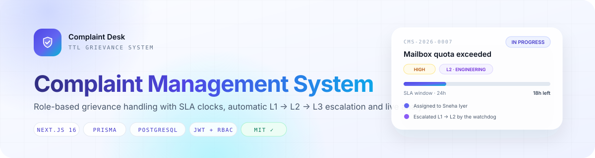
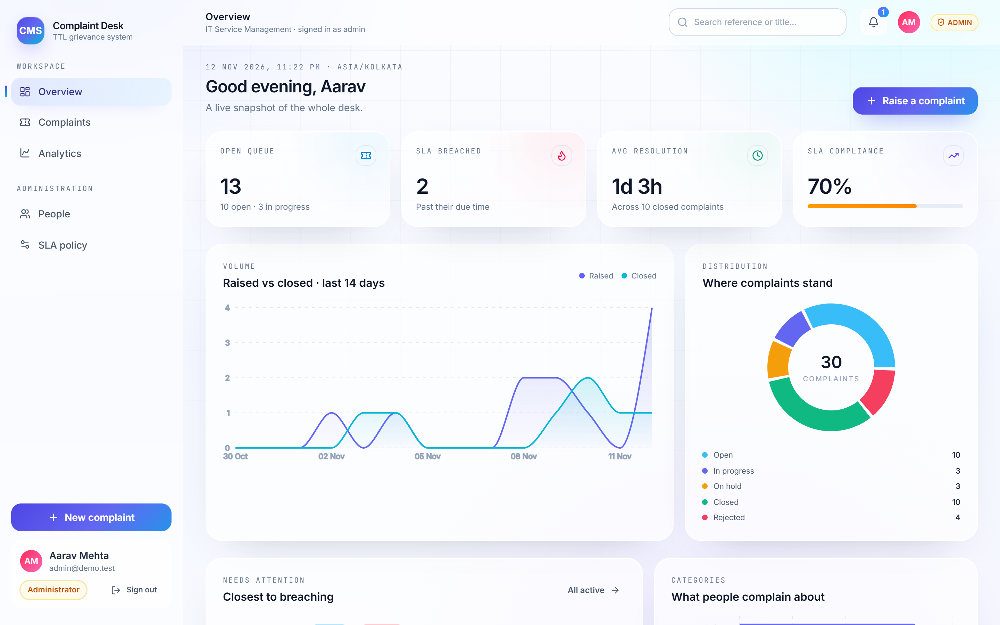
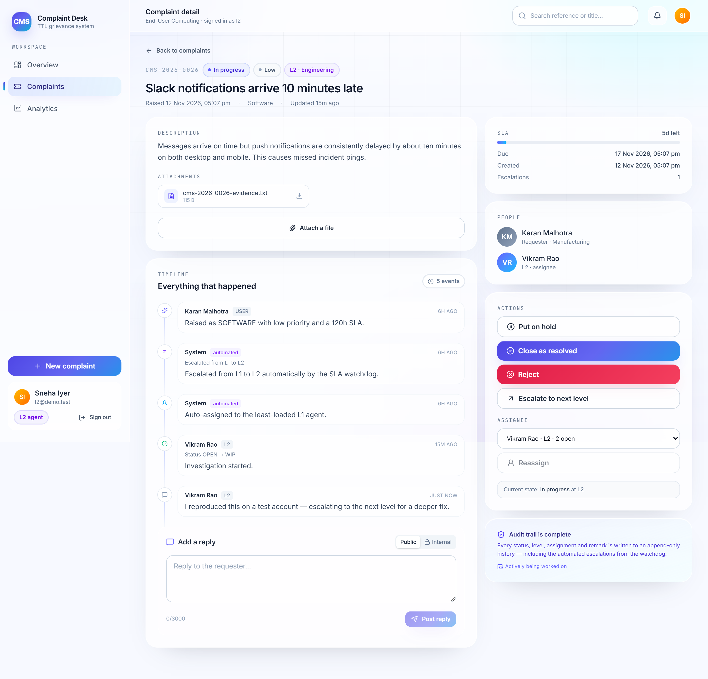
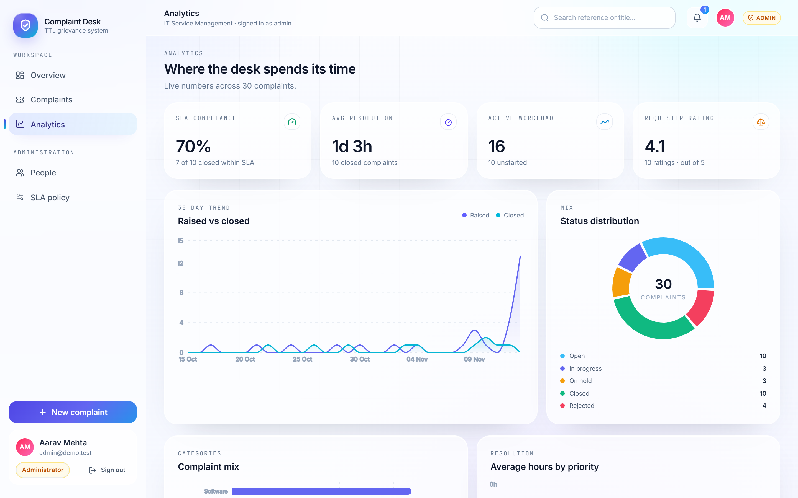
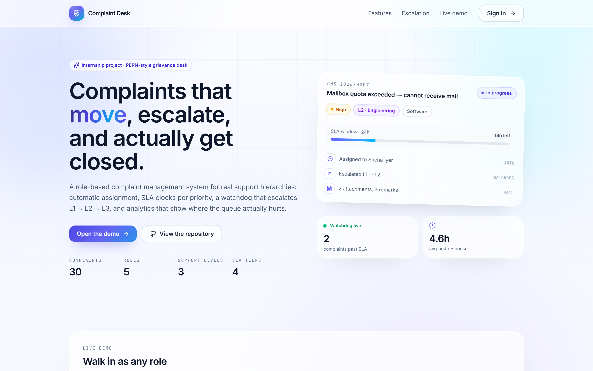
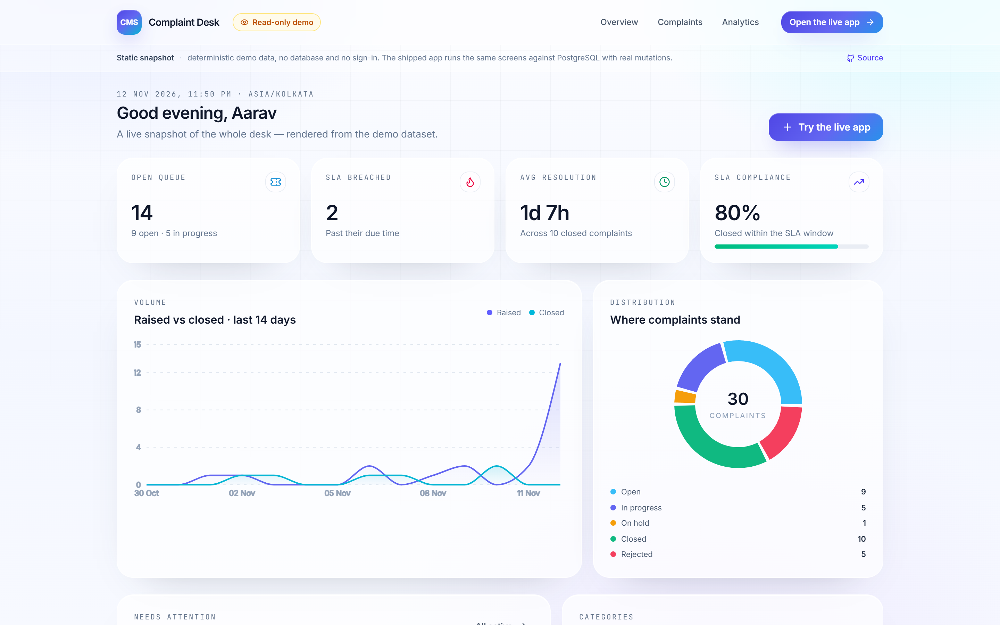
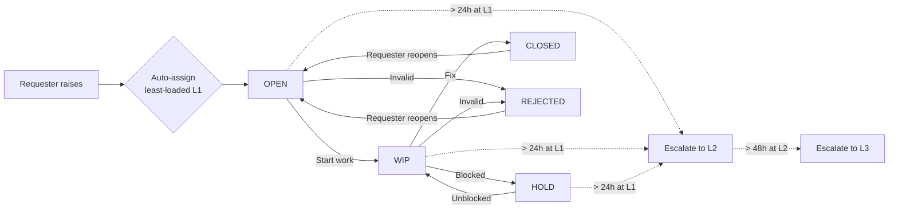

# Complaint Management System



[](https://github.com/Subhamdasskd/ComplaintManagementSystem/actions/workflows/ci.yml)
[](LICENSE)
[](.nvmrc)
[](src/lib)

A role-based complaint management system for real support hierarchies: requesters raise
complaints, an algorithm assigns them to the least-loaded L1 agent, SLA clocks run per
priority, and an unattended watchdog escalates unresolved work up L1 → L2 → L3.

Built as the implementation of an internship project specification and deployed as a fully
working demo you can sign into in one click.

## Try it without an account

**Live:** <https://complaint-management-system-alpha-ten.vercel.app>

Two ways in:

| Path | What it is | Needs a database? |
|---|---|---|
| [`/demo`](https://complaint-management-system-alpha-ten.vercel.app/demo) | A read-only snapshot rendered from deterministic demo data — overview, complaint list, a full timeline and analytics | No |
| `/login` | The real application: real sessions, real writes, real cron | Yes |

The demo exists so the deployment is explorable the moment it ships, and so screenshots and
code review can be done without seeding anything: `src/lib/demo/dataset.ts` generates the same
30 complaints deterministically, and the demo routes render them through the same components
as the live pages. Mutations are disabled there by design.

For the live app, the landing page has one-click role cards (no password) once the database is
seeded:

| Role | Account | What they see |
|---|---|---|
| Requester | `user@demo.test` | Only their own complaints, the timeline and a rating form when closed |
| L1 service desk | `l1@demo.test` | Every L1 complaint plus their own assignments |
| L2 engineering | `l2@demo.test` | L1 and L2 complaints, reassignment, escalation |
| L3 specialist | `l3@demo.test` | Everything up to L3 — the end of the ladder |
| Administrator | `admin@demo.test` | Whole desk, user management, SLA and escalation policy |

All demo accounts share the password `Demo@12345` if you prefer the form.

## Screenshots

| Dashboard | Complaint detail |
|---|---|
|  |  |

| Analytics | Landing page |
|---|---|
|  |  |

The read-only demo shipped at `/demo`, captured from the live deployment:



## Features

- **Five roles, one system** — requester, L1, L2, L3 and administrator each get their own
  navigation, queue scope and permitted actions.
- **Automatic assignment** — every new complaint goes to the active agent at the right level
  with the smallest open queue, and that agent is notified in-app.
- **SLA clocks per priority** — critical 4h, high 24h, medium 72h, low 120h. Every card shows
  the countdown, consumption bar and a breach flag; policy is editable by an administrator.
- **Automatic escalation** — a cron sweep moves complaints past their level window up one
  level, reassigns them to the least-loaded agent at the new level and notifies both sides.
- **Complete audit trail** — every status, level, assignment, remark and rating appends an
  immutable `StatusEvent`, including which events were automated.
- **Attachments** — up to 3 files per complaint (2 MB each), stored in Postgres and streamed
  back only to viewers who can see the complaint.
- **Remarks with internal notes** — staff can post replies the requester sees, or internal
  notes that never leave the support side.
- **Search, filters and pagination** — by reference, title, description, status, priority,
  category, level, assignee and sort order.
- **Analytics** — 30-day volume trend, status mix, category split, average resolution hours by
  priority, SLA compliance, CSAT average and per-agent workload.
- **Administration** — create people, change roles, deactivate accounts (the last admin is
  protected), and tune SLA and escalation windows.
- **Hardened auth** — bcrypt password hashing, HS256 JWT session in an httpOnly cookie,
  middleware-protected routes and server-side permission checks on every API route.

## How a complaint moves



1. The requester submits a complaint with a category and priority. A `CMS-YYYY-NNNN`
   reference is allocated atomically and the SLA deadline is derived from the priority.
2. `src/lib/assign.ts` picks the active agent at L1 with the fewest open complaints and
   records the assignment on the audit trail.
3. Staff move the complaint through the allowed transitions. Each move writes a `StatusEvent`,
   updates `closedAt`/`resolvedInMin` and notifies the requester.
4. `GET /api/cron/escalate` (Vercel Cron, or manually with the secret) calls
   `runEscalations()`: anything past its level window moves up a level, gets a new assignee,
   and is flagged if it has also blown its due date.
5. When a complaint is closed the requester can rate it, which feeds the CSAT metric.

## Stack

| Layer | Choice |
|---|---|
| Framework | Next.js 16 (App Router, Turbopack) |
| Language | TypeScript (strict) |
| UI | Tailwind CSS v4, lucide-react, Recharts |
| Auth | JWT (jose) in an httpOnly cookie, bcrypt password hashing |
| Data | Prisma 6 — PostgreSQL locally and in production |
| Tests | Vitest (37 unit tests on SLA, escalation and RBAC) |
| Deploy | Vercel + Neon/Supabase Postgres, Vercel Cron for the watchdog |

## Local setup

Requires Node 20.9+ and a PostgreSQL database.

```bash
npm install
cp .env.example .env.local     # point DATABASE_URL at your database
npx prisma db push             # create the tables
npm run db:seed                # 30 complaints, 9 people, a month of history
npm run dev
```

Open <http://localhost:3000> and press a demo role card.

### Environment

| Variable | Needed for | Purpose |
|---|---|---|
| `DATABASE_URL` | always | PostgreSQL connection string |
| `AUTH_SECRET` | always | Signs session cookies (32+ random bytes) |
| `CRON_SECRET` | production | Protects `/api/cron/escalate` (Vercel Cron sends it automatically) |
| `SEED_DEMO_PASSWORD` | optional | Password for seeded accounts (default `Demo@12345`) |
| `NEXT_PUBLIC_APP_NAME` | optional | Shown in metadata |

Generate a secret with:

```bash
node -e "console.log(require('crypto').randomBytes(32).toString('base64url'))"
```

## Scripts

| Command | What it does |
|---|---|
| `npm run dev` | Development server on :3000 |
| `npm run build` | `prisma generate` + production build |
| `npm start` | Serve the production build |
| `npm test` | Vitest unit suite |
| `npm run smoke [url]` | End-to-end HTTP smoke test against a running deployment |
| `npm run lint` | ESLint (Next.js flat config) |
| `npm run typecheck` | `tsc --noEmit` |
| `npm run db:push` | Apply the Prisma schema to the database |
| `npm run db:seed` | Reset and seed the demo dataset |

## Access control

| Action | Requester | L1 | L2 | L3 | Admin |
|---|---|---|---|---|---|
| Raise a complaint | ✅ | ✅ | ✅ | ✅ | ✅ |
| See own complaints | ✅ | ✅ | ✅ | ✅ | ✅ |
| See complaints at their level | — | L1 | L1–L2 | L1–L3 | all |
| Public reply | own | ✅ | ✅ | ✅ | ✅ |
| Internal note | — | ✅ | ✅ | ✅ | ✅ |
| Change status | confirm/reopen own | assigned + L1 | assigned + L1–L2 | assigned + all | all |
| Reassign | — | — | ✅ | ✅ | ✅ |
| Escalate | — | own level | ✅ | ✅ | ✅ |
| Manage people and policy | — | — | — | — | ✅ |

All of it lives in `src/lib/rbac.ts` — one module, shared by the UI and every API route.

## Project layout

```
src/
├── app/
│   ├── page.tsx                      # landing page with one-click demo login
│   ├── login/ register/              # auth screens
│   ├── (demo)/demo/                  # read-only demo, no database required
│   │   ├── page.tsx                  # demo overview
│   │   ├── complaints/               # demo list + timeline
│   │   └── analytics/
│   ├── (app)/                        # authenticated shell
│   │   ├── dashboard/                # stats, charts, what needs attention
│   │   ├── complaints/               # list, new, [id] detail + timeline
│   │   ├── analytics/                # SLA, resolution and workload reporting
│   │   ├── admin/users/              # people management
│   │   ├── admin/settings/           # SLA + escalation policy
│   │   └── notifications/
│   └── api/
│       ├── auth/                     # login, register, logout, demo
│       ├── complaints/[id]/          # status, assign, escalate, remarks, feedback
│       ├── attachments/[id]/         # authorised file streaming
│       ├── admin/                    # people + policy
│       └── cron/escalate/            # the SLA watchdog
├── components/                       # ui primitives, charts, complaint widgets
└── lib/
    ├── complaints.ts                 # all mutations + audit trail
    ├── rbac.ts                       # permissions and visibility
    ├── escalation.ts                 # pure escalation decision
    ├── sla.ts                        # due dates, breaches, durations
    ├── assign.ts                     # least-loaded assignment
    ├── settings.ts                   # policy read/write
    ├── session.ts, auth.ts           # JWT session + bcrypt
    └── demo/dataset.ts               # deterministic demo data (no database)
prisma/
├── schema.prisma                     # User, Complaint, Remark, Attachment, StatusEvent…
└── seed.ts                           # deterministic demo dataset
```

## Deployment (Vercel + Postgres)

1. Create a free PostgreSQL database (Neon or Supabase) and copy the pooled connection
   string — it must include `?sslmode=require`.
2. Import this repository into Vercel. `vercel.json` already sets
   `buildCommand: prisma generate && next build` and the cron schedule.
3. Add the environment variables: `DATABASE_URL`, `AUTH_SECRET`, `CRON_SECRET`.
4. Create the tables and seed the demo data **once**, against the production database:

   ```bash
   DATABASE_URL="<production-url>" npx prisma db push
   DATABASE_URL="<production-url>" npm run db:seed
   ```

5. Deploy. `vercel.json` schedules `/api/cron/escalate` daily at 02:00 UTC; on a Vercel Pro
   plan you can tighten that to hourly (`0 * * * *`) for a livelier watchdog.

The seed is idempotent — it clears and rebuilds the demo dataset, so never point it at a
database containing real complaints.

## Tests

```bash
npm test                                  # unit suite
npm run smoke                             # end-to-end against localhost:3100
npm run smoke -- https://your-deployment  # end-to-end against a deployment
```

37 unit tests cover the pure logic that is easy to get wrong: the escalation ladder and its
windows, SLA due dates and breach detection, duration formatting, and every RBAC decision
(visibility, transitions, reassignment, escalation, feedback).

`scripts/smoke.mjs` drives the real HTTP surface with no dependencies: it signs in through the
demo endpoint, raises a complaint with an attachment, posts a public reply and an internal note,
checks that the requester cannot reject or reassign, escalates from L1 to L2, closes, rates,
reopens, downloads the attachment, and confirms validation and RBAC refusals. It exits non-zero
on the first failure, so it can gate a deploy.

## Documentation

| Document | Contents |
|---|---|
| [docs/architecture.md](docs/architecture.md) | Data model, API surface, escalation sequence |
| [CONTRIBUTING.md](CONTRIBUTING.md) | Local setup, conventions, adding a permission |
| [SECURITY.md](SECURITY.md) | Reporting vulnerabilities, deployment checklist |
| [CODE_OF_CONDUCT.md](CODE_OF_CONDUCT.md) | Community expectations |
| [CHANGELOG.md](CHANGELOG.md) | Release history |
| [LICENSE](LICENSE) | MIT |

## Limitations

- Email/SMS delivery is not wired up; notifications are in-app only.
- Attachments are capped at 2 MB because they are stored in Postgres rather than object
  storage. Swapping in Vercel Blob or S3 is a two-file change.
- The watchdog runs on a schedule, so escalation is eventually consistent rather than instant.
- There is no multi-tenant/organisation layer: the deployment serves one complaint desk.
