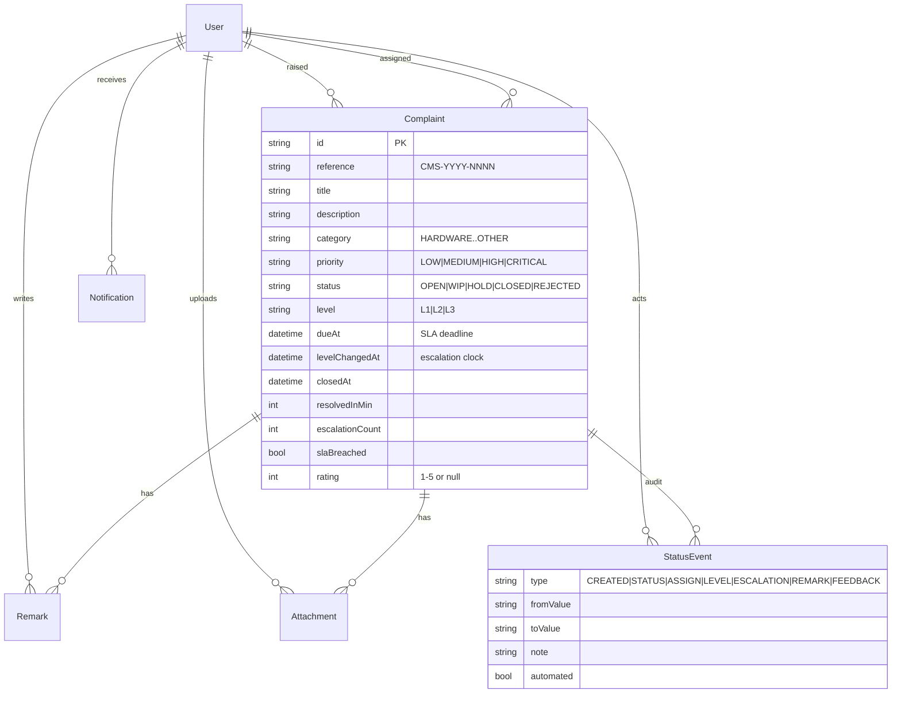
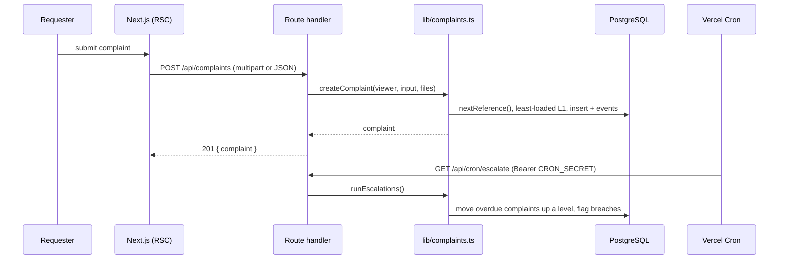

# Architecture

## Data model

`StatusEvent` is append-only: status changes, assignments, escalations, remarks and ratings all
land there, so the timeline on a complaint page is a projection of that table (remarks are
rendered from `Remark` with their own author and visibility flag).

Because the complaint level and the staff role share the same `L1|L2|L3` vocabulary, visibility
is a rank comparison rather than a join table.

## Request flow

## API surface

| Method | Route | Who | Purpose |
|---|---|---|---|
| `POST` | `/api/auth/login` | public | Email + password → session cookie |
| `POST` | `/api/auth/register` | public | Create a requester account |
| `POST` | `/api/auth/demo` | public | Sign in as a seeded demo role |
| `POST` | `/api/auth/logout` | any | Clear the session |
| `GET` | `/api/complaints` | any signed in | Visible complaints, filtered |
| `POST` | `/api/complaints` | any signed in | Raise a complaint (JSON or multipart with files) |
| `GET` | `/api/complaints/[id]` | visible | One complaint with remarks and attachments |
| `POST` | `/api/complaints/[id]/status` | staff / requester confirm | Status transition |
| `POST` | `/api/complaints/[id]/remarks` | visible | Public reply or internal note |
| `POST` | `/api/complaints/[id]/assign` | L2+ | Reassign (or unassign) |
| `POST` | `/api/complaints/[id]/escalate` | staff at level | Manual escalation |
| `POST` | `/api/complaints/[id]/feedback` | requester | Rating on a closed complaint |
| `POST` | `/api/complaints/[id]/attachments` | visible | Add a file |
| `GET` | `/api/attachments/[id]` | visible | Stream a file |
| `GET`/`POST` | `/api/notifications` | signed in | List / mark read |
| `GET`/`POST` | `/api/admin/users` | admin | List / create people |
| `PATCH` | `/api/admin/users/[id]` | admin | Role, status, password |
| `GET`/`PUT` | `/api/admin/settings` | admin | SLA and escalation policy |
| `GET`/`POST` | `/api/cron/escalate` | cron secret | Run the watchdog |

## Design decisions

**Why the policy lives in the database.** SLA and escalation windows are the two numbers an
operations team will always want to tune. They sit in a `Setting` key/value table, are read
through `getSettings()` with compiled-in defaults, and are editable at
`/admin/settings` without a redeploy.

**Why escalation is a pure function.** `shouldEscalate()` takes the status, level, timestamp
and policy and returns a boolean. The cron route is a thin wrapper, which makes the rules
unit-testable without a database and impossible to drift from the tests.

**Why references are allocated with raw SQL.** `nextReference()` runs an atomic
`INSERT … ON CONFLICT DO UPDATE … RETURNING` inside the complaint transaction, so two
simultaneous submissions can never produce the same `CMS-YYYY-NNNN`.

**Why permissions are centralised.** `src/lib/rbac.ts` exports both predicates (`canView`,
`canChangeStatus`, `canEscalate`) and a Prisma `where` fragment (`visibleComplaintFilter`).
The UI uses the predicates to decide which buttons to render, and the API uses the same
predicates plus the fragment to decide what the request may touch — one source of truth.

**Why server components read Prisma directly.** The dashboard, list and detail pages query
through Prisma in the server component, so there is no client-side data fetching, no loading
spinner on first paint, and the session cookie is never sent to an API just to render a page.
